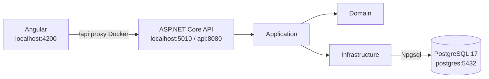

# 1. DentalPro en una vista

## Propósito

DentalPro centraliza tareas de un consultorio odontológico: identidad y permisos, pacientes, agenda e información clínica. El backend es un monolito modular ASP.NET Core; Angular es cliente web y PostgreSQL conserva el estado.

## Tecnologías verificadas

| Parte | Versión/configuración actual |
|---|---|
| Backend | .NET / ASP.NET Core `net10.0` |
| EF Core | `10.0.12` |
| Proveedor EF PostgreSQL | `Npgsql.EntityFrameworkCore.PostgreSQL 10.0.3` |
| PostgreSQL Compose | `postgres:17-alpine` |
| Angular | `^21.2.0`; CLI/build `^21.2.26` |
| Node Docker | `node:22-alpine` |
| npm | `10.9.0` declarado en `packageManager` |
| Tests .NET | xUnit 2.9.2; MVC Testing 10.0.12 |
| Tests Angular | builder Angular, Vitest 4.0.8, jsdom 28.0.0 |

La arquitectura documentada habla de PostgreSQL 18, pero Compose ejecuta PostgreSQL 17. Esta guía describe Compose; confirmar la discrepancia antes de afirmar soporte de la versión 18.

## Mapa del repositorio

- `src/DentalPro.Domain`: agregados y reglas sin dependencia de web o base de datos.
- `src/DentalPro.Application`: casos de uso, contratos y excepciones.
- `src/DentalPro.Infrastructure`: Identity, EF Core, repositorios, transacciones y PostgreSQL.
- `src/DentalPro.Api`: composición del host, Minimal APIs, contratos HTTP y filtros.
- `frontend/src/app`: componentes, routing, servicios, modelos y autenticación Angular.
- `tests/DentalPro.UnitTests`: reglas de dominio y casos de uso.
- `tests/DentalPro.IntegrationTests`: API, modelo EF y pruebas condicionadas a PostgreSQL.
- `docs`: requisitos, dominio, arquitectura y ADRs.

## Diagrama

El proxy Docker del servidor Angular apunta a `http://api:8080`; ese DNS solo existe dentro de Compose. En ejecución local, `frontend/proxy.conf.json` apunta a `http://localhost:5010`.

## Servicios Compose

`docker-compose.yml` define `postgres`, `api` y `frontend`. Publica PostgreSQL 5432, API 5010 y Angular 4200 en loopback. Postgres usa volumen explícito `dentalpro_postgres_data`. La API espera PostgreSQL healthy; frontend espera el healthcheck TCP de API. El API healthcheck no verifica migraciones ni SQL; frontend no tiene healthcheck.

Compose no aplica migraciones ni ejecuta bootstrap automáticamente. Ver [entorno](02-environment-setup.md).
