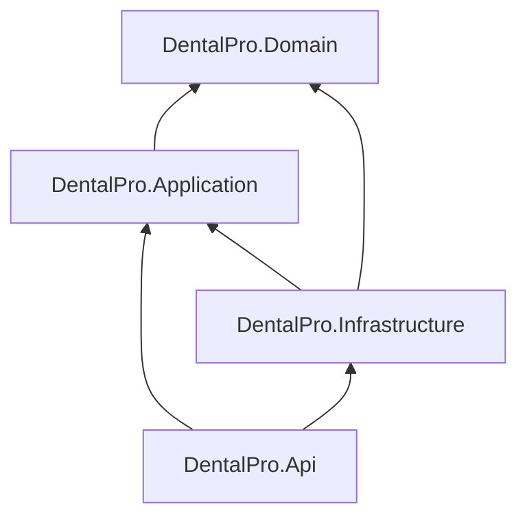
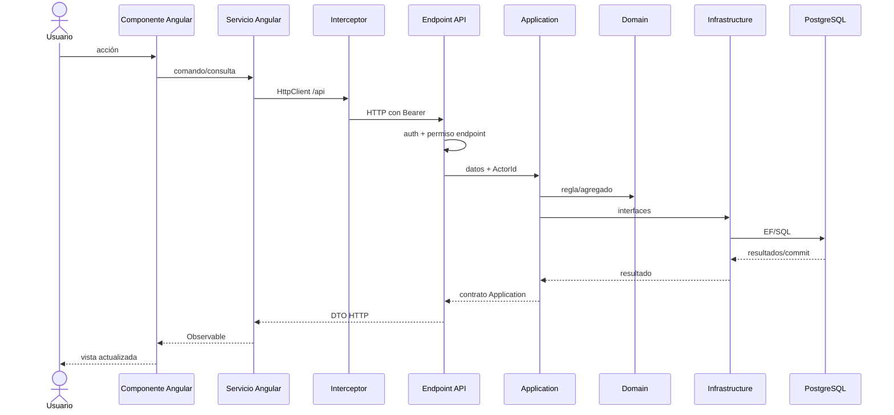

# 3. Arquitectura y dependencias

## Monolito modular

Se despliega una API y PostgreSQL compartidos, con límites internos por responsabilidad. No hay una razón técnica observada para desplegar cada módulo como microservicio; eso añadiría red, despliegues múltiples y consistencia distribuida sin necesidad actual. Las fronteras de proyectos permiten mantener cohesión sin ese costo.

`Program.cs` compone dependencias. Application conoce abstracciones como `IAppointmentRepository`, no `DbContext`. Infrastructure implementa esas abstracciones. Domain no referencia ASP.NET, EF Core, Identity ni Npgsql.

## Capas

### Domain

Contiene conceptos e invariantes independientes del transporte. `Patient.Create` exige datos identificatorios básicos y rechaza nacimiento futuro; `Appointment` controla transición; `ClinicSchedule` valida configuración/intervalos. Fábricas y mutadores públicos mantienen estado válido; setters privados limitan modificaciones externas.

### Application

Coordina intenciones. `CreateAppointment` valida permiso y alcance, participantes, horario, disponibilidad, guarda y pide auditoría vía interfaces. `CreatePatient` delega creación al Domain y almacenamiento a `IPatientRepository`. Application no conoce códigos HTTP.

### Infrastructure

Implementa EF, PostgreSQL, Identity, repositorios, consultas de permiso, locks y auditoría. `DentalProDbContext` deriva de `IdentityDbContext`; configuraciones EF declaran tipos, claves e índices. SQL/locks/especificidades PostgreSQL permanecen aquí.

### API

`Program.cs` registra host/servicios y mapea Minimal API. Handlers enlazan query/route/body, extraen identidad, llaman Application y construyen DTO HTTP. Requests/responses no son entidades Domain ni EF.

### Angular

Presenta flujos, llama rutas relativas `/api` y muestra controles según permisos. El servidor Angular proxy retransmite solicitudes durante desarrollo. La API siempre vuelve a autenticar y autorizar.

## Ciclo de una solicitud

## Transacciones por flujo

Agenda y ClinicalRecords comparten `AppointmentUnitOfWork`: inicia transacción, ejecuta callback, guarda y confirma; si falla revierte y limpia ChangeTracker. Las operaciones de pacientes usan `PatientRepository` y no el UoW compartido. No supongas una transacción universal.

Reserva bloquea configuración con `FOR SHARE`; cambio de horario usa `FOR UPDATE`, ambos dentro del UoW. Las exclusion constraints PostgreSQL impiden solapamientos aun con escrituras concurrentes. La comprobación de disponibilidad aislada no bastaría frente a dos solicitudes simultáneas.
