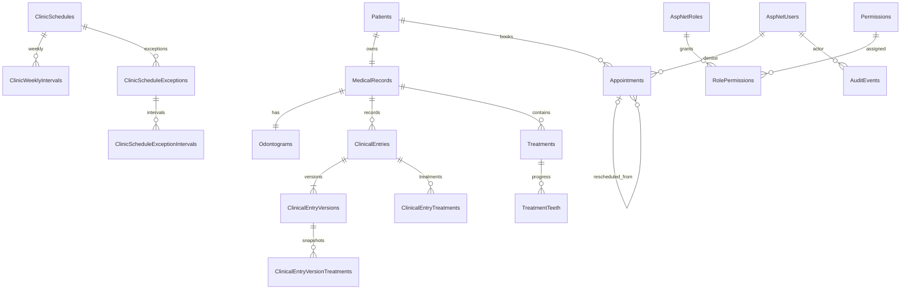

# 6. Persistencia y esquema

## Contexto y conexión

`DentalProDbContext` deriva de `IdentityDbContext<ApplicationUser, IdentityRole<Guid>, Guid>`. Infrastructure lee `ConnectionStrings:DentalPro`; Compose pasa `ConnectionStrings__DentalPro` con host `postgres`. `DentalProDbContextFactory` sirve a tooling de diseño y ofrece fallback local `localhost:5432/dentalpro_dev`; operaciones EF dentro de Docker usan variables del servicio.

## Diagrama relacional principal



Es un mapa de relaciones principales, no todas las columnas ni las tablas internas de Identity. La configuración EF/migración es referencia exacta antes de SQL manual.

## Tablas y restricciones clave

| Área | Tablas | Ejemplos de integridad |
|---|---|---|
| Pacientes | `Patients`, `MedicalRecords`, `Odontograms` | documento único tipo+número; record uno a uno; secuencia `medical_record_number_seq` |
| Identity | `AspNetUsers`, `AspNetRoles`, tablas estándar | usuarios y roles Guid; membresía por `AspNetUserRoles` |
| RBAC | `Permissions`, `RolePermissions` | code único; PK compuesta role/permission |
| Agenda | `Appointments`, `AuditEvents` | FK restrictivas, estado/fechas/duración checks, índices por paciente/dentist, exclusiones PostgreSQL |
| Horarios | `ClinicSchedules`, `ClinicWeeklyIntervals`, `ClinicScheduleExceptions`, `ClinicScheduleExceptionIntervals` | schedule singleton; fecha única; límites start<end |
| Historia | `ClinicalEntries`, `ClinicalEntryVersions`, `ClinicalEntryTreatments`, `ClinicalEntryVersionTreatments` | versiones positivas y únicas por entrada; tablas de asociación |
| Tratamiento | `Treatments`, `TreatmentTeeth` | checks de estado/tipo/prioridad/FDI y progreso por pieza |

Migraciones presentes en orden: `20261013021751_InitialPatientPersistence`, `20261104034329_AddIdentityAndRbacPersistence`, `20261111005924_AddAppointmentPersistence`, `20261111032751_AddAppointmentAuditAndOverlapConstraints`, `20261115005635_AddClinicScheduleAndAppointmentDuration`, `20261115160242_ValidateClinicScheduleTimeZone`, `20261115224207_AddClinicalRecordsAndTreatments`.

Hay DDL PostgreSQL particular (exclusion constraints, trigger/funciones de inmutabilidad). Inspeccioná `Up()` y SQL generado; un resumen de tablas no describe todos los efectos.

## Diferencias entre alcance y código

DbContext tiene `Odontograms`, pero no `OdontogramTooth` ni `ToothStateHistory`; hoy se crea odontograma vacío. ClinicalEntry crea snapshot inicial y puede consultarse, pero no hay caso de uso/API de edición que cree versiones posteriores. No describir esas capacidades como operativas.

## Generar e inspeccionar migración

La herramienta local se fija en `.config/dotnet-tools.json` (`dotnet-ef 10.0.12`). Desde raíz, luego de modificar modelo/configuración:

```powershell
dotnet tool restore
dotnet ef migrations add NombreDescriptivo --project src/DentalPro.Infrastructure --startup-project src/DentalPro.Api
```

Revisá `Up`, `Down`, designer, snapshot y SQL:

```powershell
dotnet ef migrations script --idempotent --project src/DentalPro.Infrastructure --startup-project src/DentalPro.Api --output .\migration-review.sql
```

Aplicar es explícito. En Compose:

```powershell
docker compose run --rm api dotnet tool restore
docker compose run --rm api dotnet ef database update --project src/DentalPro.Infrastructure --startup-project src/DentalPro.Api
```

La API normal no llama `Migrate()` al arrancar. Antes, verificá connection string, destino e historial.

## Rollback y respaldo

`Down()` puede eliminar estructuras y con ellas datos creados desde `Up()`. No es rollback automáticamente seguro. Leé código generado y toma backup antes de bajar versión.

Ejemplo de backup PostgreSQL vía contenedor, usando los valores reales de `.env`:

```powershell
docker compose exec -T postgres pg_dump -U dentalpro -d dentalpro_dev -Fc -f /tmp/dentalpro.dump
docker compose cp postgres:/tmp/dentalpro.dump .\dentalpro.dump
```

Para restaurar en una base de destino previamente creada y vacía (ejemplo `dentalpro_restore`):

```powershell
docker compose exec postgres createdb -U dentalpro dentalpro_restore
docker compose cp .\dentalpro.dump postgres:/tmp/dentalpro.dump
docker compose exec postgres pg_restore -U dentalpro -d dentalpro_restore /tmp/dentalpro.dump
```

Reemplazá usuario/base con destino real. No agregues `--clean` a una base con datos: ese flag elimina objetos existentes. Practicá primero con una base aislada y verifica `pg_restore --list`; nunca restaures sobre `dentalpro_dev` sin respaldo, plan y confirmación explícita del destino. El volumen no reemplaza backup externo.
