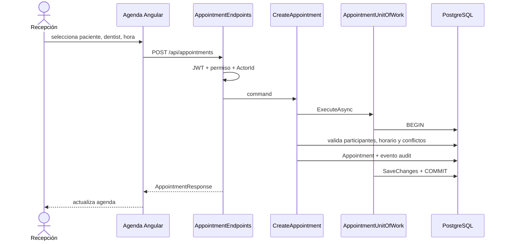

# 8. Flujos de negocio de extremo a extremo

Los endpoints y clases citados se verificaron en el código. Los filtros de cada módulo convierten errores conocidos de Application a HTTP.

## Pacientes

### Crear paciente

1. En `patients/patient-list`, usuario llena formulario.
2. `PatientsApiService.create()` envía `POST /api/patients`.
3. `PatientEndpoints.CreateAsync` valida campos y endpoint exige `patients.create`.
4. `CreatePatient.ExecuteAsync` llama `Patient.Create`.
5. Domain verifica requeridos y nacimiento no futuro; genera PatientId, MedicalRecord y Odontogram vacío.
6. `PatientRepository.AddAsync` persiste el conjunto y asigna número secuencial de historia.
7. API responde `PatientResponse`; lista actualiza.

Índice único de tipo+número documento evita duplicado; API responde conflicto. `PUT /api/patients/{id}` actualiza información personal, no contenido clínico ni turnos.

Validación repartida por capa: Domain requiere tipo/documento/nombre/apellido no vacíos y fecha de nacimiento no futura; el endpoint también comprueba formato email cuando viene informado; el repositorio/PostgreSQL garantiza unicidad del documento compuesto. Las columnas son `text`, así que la configuración mostrada no define límites de longitud SQL. Teléfono y domicilio son opcionales y no tienen formato de dominio definido. No inventes reglas de teléfono, documento o longitudes al ampliar formulario.

### Buscar y consultar detalle

`GET /api/patients?search=...` llama `ListPatients` → `IPatientRepository.SearchAsync`. Infrastructure divide la consulta por espacios; cada término debe coincidir, sin distinguir mayúsculas, parcialmente con nombre, apellido, número o tipo de documento (`ILIKE`). `%`, `_` y `\` se escapan para que se interpreten como texto. Por eso una búsqueda con varios términos requiere que cada token encuentre coincidencia en alguno de esos campos. Detalle usa `GET /api/patients/{id:guid}` → `GetPatient`. La ruta transmite `Patient.Id`; no confundir con `MedicalRecord.Id` ni `ClinicalEntry.Id`.

## Agenda

### Endpoints de agenda

| Ruta | Permiso | Uso |
|---|---|---|
| `GET /api/appointments?from=&to=&dentistId=` | `appointments.view` | Lista por intervalo y dentist opcional; Application limita scope |
| `GET /api/appointments/availability?from=&to=&dentistId=&patientId=` | `appointments.view` | Consulta informativa |
| `GET /api/appointments/dentists` | `appointments.create` | Lista de dentists activos para selección |
| `POST /api/appointments` | `appointments.create` | Crear |
| `POST /api/appointments/{id}/reschedule` | `appointments.update` | Reprogramar, original queda Rescheduled |
| `POST /api/appointments/{id}/cancel` | `appointments.cancel` | Cancelar sin borrar |
| `POST /api/appointments/{id}/confirm` | `appointments.confirm` | Confirmar |
| `POST /api/appointments/{id}/complete` | `appointments.complete` | Completar |

Disponibilidad informativa no reserva. Crear/reprogramar revisan otra vez dentro de transacción. Paciente debe existir/estar activo; dentist debe existir, estar activo y tener condición Dentist. El bloque debe caber en horario abierto. No existe horario predeterminado: sin schedule, operaciones relacionadas devuelven error de configuración.

La zona IANA de la clínica interpreta hora local; timestamps se guardan UTC. Hora local ambigua/inexistente se rechaza; el offset de API debe corresponder a zona. Intervalos `[inicio, fin)` permiten adyacencia. Default duration aplica si create no recibe duración; reprogramación conserva duración previa si no recibe una nueva.

Estados admitidos: `Scheduled → Confirmed`, `Completed`, `Cancelled`, `Rescheduled`; `Confirmed → Completed`, `Cancelled`, `Rescheduled`. Completed/Cancelled/Rescheduled son terminales. Scheduled, Confirmed y Completed bloquean; Cancelled/Rescheduled quedan trazables sin bloquear.

### Configuración de horarios

Rutas en `/api/appointments/schedule`: `GET` configuración completa, `GET /settings` lectura informativa, `POST` crear, `PUT` reemplazar configuración, `PUT /exceptions/{date}` registrar excepción y `DELETE /exceptions/{date}` eliminar excepción. Cambios exigen `appointments.schedule.manage`; settings para lectura `appointments.view`. Debe configurarse zona horaria, duraciones/incrementos y franjas. No se fija horario laboral en código. Hay métodos de servicio Angular para estas rutas; no se encontró una página administrativa de horarios registrada en `app.routes.ts`.

## Historia clínica y tratamientos

`GET /api/patients/{patientId}/medical-record` llama `GetClinicalRecord`; comprueba permiso y scope clínico. Dentist consulta su alcance salvo permiso `clinical.records.view.all`.

`POST /api/patients/{patientId}/medical-record/entries` crea entrada. `CreateClinicalEntry` exige permiso `clinical.entries.create`; si incluye tratamientos, también `clinical.treatments.create`. Comprueba paciente activo, dentist actor activo, alcance y coherencia de appointment opcional. Carga MedicalRecord para update, crea ClinicalEntry, `ClinicalEntryVersion.Initial`, Treatments y TreatmentTeeth, actualiza actividad y registra auditoría en unidad de trabajo clínica compartida.

Treatment puede involucrar varias piezas FDI permanentes. En estado parcialmente completado se requieren dientes completados válidos y dientes pendientes; cada `TreatmentTooth` conserva estado, fecha/notas/resultado por separado.

## Límites observados

Aunque documentación de dominio reserva `OdontogramTooth` y `ToothStateHistory`, hoy se crea odontograma vacío sin API de mutación/consulta de piezas. La API crea versión inicial de ClinicalEntry y la devuelve en historia; no expone edición que genere nuevas versiones. No presentar esas capacidades como disponibles.
